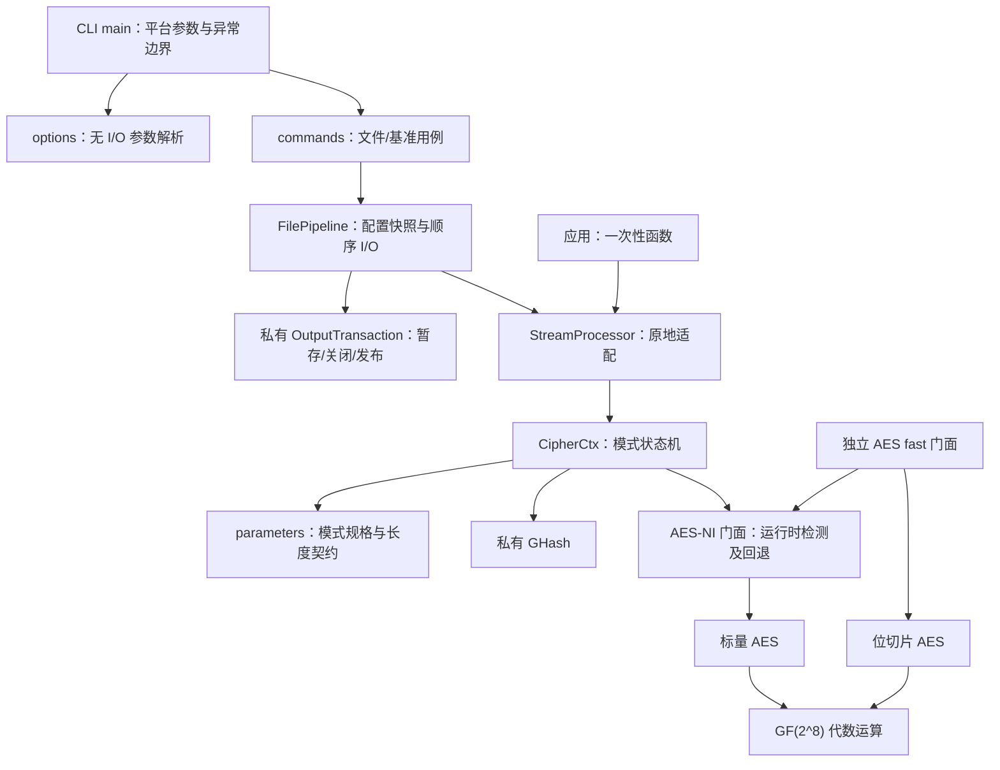

# StreamCipher 当前架构

公共契约见 [API](api.md)，构建和操作见 [开发使用](user-guide.zh-CN.md)，本地安装/ZIP见 [打包](delivery.zh-CN.md)。历史方案和验收时点见 [历史索引](history/README.md)。

## 目标和边界

这是 C++20 AES-128 算法与文件处理原型：实现 96 位 nonce 的 CTR，以及空 AAD、128 位标签的 GCM。选择单一导出库，内部按职责拆分；不为仅两个模式引入插件系统或多个二进制组件。性能需实测，本项目没有证明优于其他密码库。

支持范围是由调用方控制、稳定的普通输入文件和受信任的输出目录。Windows 输出目录应具有适当的私有 ACL。调用方负责密钥保管和同一密钥下 nonce 唯一性。API 不提供攻击者可并发操纵目录下的句柄安全、文件快照、断电持久事务或崩溃恢复。

## 依赖方向

`memory::secure_zero` 是跨实现使用的小型清理原语。`SlabPool` 与 `span_utils` 是可选公共工具，未接入密码/文件热路径。公共 API 头文件与私有实现分开；GHASH、标签比较、事务和清理 guard 不安装为公共头。

内部可读取的依赖并不等于 API 依赖：`cipher.hpp` 只包含参数契约，`pipeline.hpp` 不强制拉入流或 AES 头。使用多个模块的消费者应显式包含各自头文件，或使用总入口 `streamcipher.hpp`。

## 实现与阅读入口

| 入口/实现 | 职责 |
|---|---|
| `core/parameters.hpp`、`src/core/parameters.cpp` | 模式规格、长度与参数验证、认证异常 |
| `core/cipher.hpp`、`src/core/cipher.cpp` | 消息状态、计数器、部分认证块和结束状态 |
| `src/core/ghash.hpp/.cpp` | 私有GF(2^128)认证累积，不负责部分块或协议策略 |
| `core/aes.hpp`、`src/core/aes.cpp`、`aes_dispatch.cpp` | 标量算法、批量包装、fast后端选择 |
| `core/bitslice.hpp`、`src/core/bitslice.cpp`、`core/gf.hpp` | 八块位表示、轮操作与代数S-box |
| `stream/stream.hpp`、`src/stream/stream.cpp` | 原地流适配及一次性认证暂存 |
| `stream/pipeline.hpp`、`src/stream/pipeline.cpp` | 文件预检、分块、回调快照和重入保护 |
| `src/io/output_transaction.hpp`、`src/detail/` | 私有暂存/发布、擦除guard、标签比较 |
| `simd/simd.hpp`、`simd/aesni.hpp`、`src/simd/` | 稳定向量接口、CPU能力、AES-NI及软件回退 |
| `memory/`公共头、`src/memory/secure.cpp` | header-only池/span工具与字节覆盖；没有空占位源文件 |
| `apps/main.cpp`、`options.*`、`commands.cpp` | 平台参数/异常边界、无I/O解析、文件/基准执行 |

表中公共头相对 `include/streamcipher/`。建议按 parameters → cipher → stream → pipeline → OutputTransaction 阅读，再进入AES/GHASH细节；不依赖固定源码行号。

AES-128为16字节块、16字节密钥、十轮。标量及当前位切片路径采用GF(2^8)逆元与仿射变换的S-box；八块位切片的SubBytes仍提取字节计算，正逆变换共用私有编译期替换编排，并非已经实现纯布尔电路S-box。未验证电路保留在历史实验文档。

`encrypt_fast` 在构建和CPU允许时使用AES-NI，否则使用八块位切片及标量尾块。CTR/GCM上下文直接调用AES-NI门面及其标量回退，不通过 `encrypt_fast`；不能把八块路径吞吐当作文件GCM吞吐。

GHASH按最高位优先固定处理128位。GCM加密认证输出密文，解密认证输入密文；部分块只在结束时补零，再加入空AAD/密文位长度块。标签为累积结果与E_K(J0)异或；J0是nonce后附大端1。

## 单一消息状态

- `ModeSpec` 集中 tag_size、initial_counter、max_payload；CTR 从 0 开始，GCM 数据从 2 开始。
- `CipherCtx` 唯一持有计数器、剩余密钥流、GCM 部分块和完成状态。每次 update 先检查长度和缓冲区，再处理数据。
- `StreamProcessor` 只适配原地处理、累计字节数和完成操作，不再实现第二套 CTR/GCM。
- `GHash` 只处理完整认证块；部分块补零和最后长度块属于模式职责，避免把协议策略泄漏到乘法组件。
- `finalize/finish` 幂等，结束后拒绝更新；GCM 标签在完成前不可获取。
- bool方向入口和 `Direction::Encrypt/Decrypt`均保留；不改变文件格式。

## 认证和资源边界

一次性 GCM 解密先把载荷放在 O(n) 暂存区，验证成功才修改目标；文件解密把候选明文写到 O(n) 磁盘暂存，验证成功后发布。低层流 API 输出候选明文，调用者必须等待 verify_tag 成功后才使用。

文件处理的 RAM 为 O(min(chunk_size, payload))，密码状态大小固定。进度表示载荷已处理，不表示认证或发布已成功。I/O 本身会复制数据，不能称为全程零拷贝。

`secure_zero` 使用 volatile 字节覆盖；WipeGuard 覆盖异常退出路径。库清理所持轮密钥、派生状态、候选明文与工作缓冲。调用者的 key、输出明文和返回的低层 RoundKeys 仍由调用者管理。这不是寄存器、交换区、磁盘或编译器全程序侧信道保证。

## 文件事务顺序

1. 拒绝重入，复制配置和生效回调。
2. 验证 chunk、普通输入、输入输出别名、输出类型、长度和模式。
3. 打开输入，分配一个工作缓冲；在目标同盘建立独占暂存目录。
4. 循环读取、原地处理、暂存写入、调用进度。
5. 完成模式，读取并验证 GCM 标签，检查额外字节/读取错误。
6. 关闭输入，关闭输出并检查最终flush；最后同盘重命名替换目标。
7. 正常/异常路径清理暂存目录和缓冲，恢复可用状态。

POSIX 以 0700 原子创建目录；Windows 继承目标目录 ACL。输出符号链接明确拒绝。检查不能防止恶意进程在检查后改变路径；输入等长修改也不保证被发现。进程异常终止可能遗留暂存目录和候选明文，清理是尽力而为。业务需要强隔离或崩溃恢复时，应设计相应平台后端而非改变本契约的含义。

## 并发和回调

单个 CipherCtx、StreamProcessor、FilePipeline、SlabPool 不允许同时从多个线程操作；独立对象没有共享消息状态。FilePipeline 每次创建新的上下文；它可以复用，但加密另一消息时应改用具有唯一 nonce 的对象。

配置与回调在操作开始时复制。回调里更改配置或默认回调只影响之后的操作。同一对象的递归文件操作抛 logic_error，异常取消当前操作并保留原目标。回调不得销毁或移动当前正在调用它的 FilePipeline。保留的 parallel/threads 字段继续拒绝未实现的并行配置。

## 构建和发布

- 顶层默认测试/示例/CLI 开启，基准关闭；作为子目录时开发目标默认关闭。
- C++20 要求通过 target 传播，不改变父工程的目录标准。实现的 SIMD/AESNI 宏不传播，Vec128/Vec256 的公共表面不随配置改变。
- 测试工具优先复用已存在 target 或已安装包；下载开关可关闭，缺失依赖给出明确错误。开发依赖不进入 SDK 安装。
- 私有 GHASH/事务等组件在单库内组织。静态库和 Windows DLL 均有验证路径；VERSION/SOVERSION 是打包元数据，不是跨编译器 C++ ABI 稳定承诺。
- 安装导出 target、公共头、包配置和许可证；支持自定义头文件目录。0.x 包按同次版本匹配。
- 顶层安装同时提供 CLI、文档、示例与决策记录；MSVC CLI 包包含运行库，CPack ZIP 解包后单独验证 CLI 和 SDK 示例。build.ps1统一普通PowerShell的工具链加载、离线依赖、变体测试与本地打包流程；日志写入所选构建目录的logs/。
- Presets 统一 Release、Debug、software、shared、asan、minimal；Windows Ninja 需要先加载 MSVC 开发环境。

## 架构验证门槛

13 个公共头独立编译；依赖规则检查；契约/状态/回调/失败路径回归；标准密码向量；跨实现互操作；软件与硬件配置；共享库；ASan；独立嵌入和安装消费项目。测试只能证明实际运行的范围；本机没有提供 Linux/macOS/ARM 运行证据。

扩展决策见 [设计决策记录](decisions/0001-architecture-boundaries.md)。历史建议的处置见历史索引，条件性功能不视作已实现。

性能测量边界和 Linux 验证入口见 [性能评估与平台验证](architecture-assessment.zh-CN.md)。
